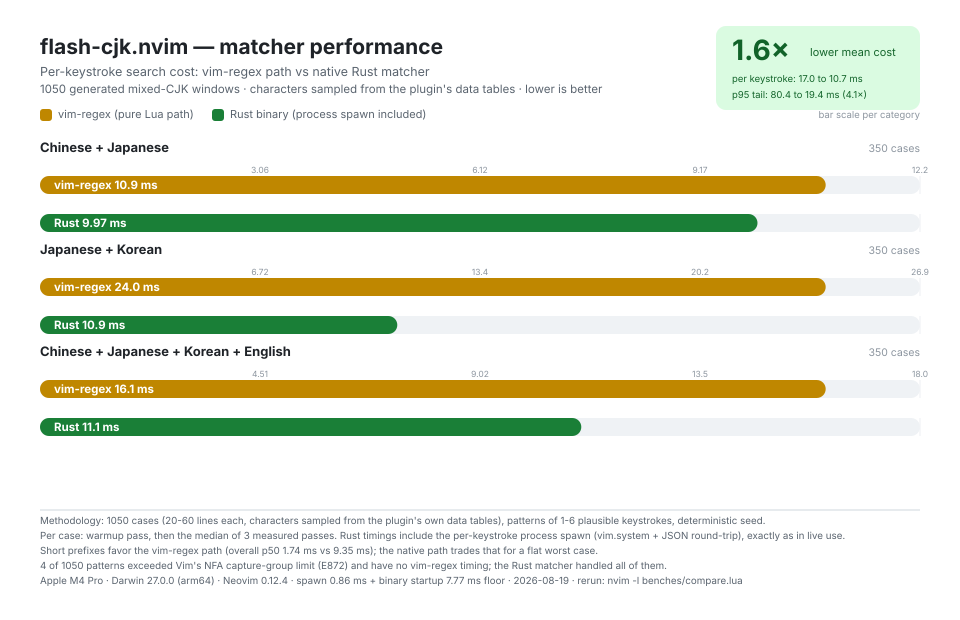

<div align="center">

# flash-cjk.nvim

Neovimで中国語・日本語・韓国語の任意の文字に、そのピンイン・ローマ字・ローマ字表記を入力してジャンプできます — IMEの切り替えは不要です。[flash.nvim](https://github.com/folke/flash.nvim) をベースに、[flash-zh.nvim](https://github.com/rainzm/flash-zh.nvim) からフォークして作られました。

[English](README.md) · [简体中文](README.zh.md) · [日本語](README.ja.md) · [한국어](README.ko.md)

[](https://github.com/fang2hou/flash-cjk.nvim/actions/workflows/validate.yml)
[](./LICENSE)

</div>

## なぜ flash-cjk.nvim なのか

ジャンプ先のCJK文字をCJK入力で指定するとなると、操作の途中でIMEと格闘することになります。flash-cjkなら手元はASCIIのままです。`ni` は 日 / に / ニ に届き、`r` はピンインの声母で 日 にヒットし、`dkss` は2ボル式（두벌식）のキー列で 안녕 にヒットします。その一方で、素のアルファベットはflash.nvimとまったく同じようにリテラル一致します。

- 対応範囲：中国語のピンイン（小鶴双拼＝中国語の双拼入力と声母）、日本語のローマ字（漢字の読み＋かな、ヘボン式と訓令式）、韓国語（改訂ローマ字＋2ボル式のキー列）、ASCIIリテラル — すべて同時に、かつ独立にオン/オフできます
- 対象外：flash.nvim自体の機能（treesitterジャンプ、リモートなど）の置き換え、IME統合、NFDの韓国語ファイル名（既知の制限を参照）
- 状態：活発に開発中

## インストール

[flash.nvim](https://github.com/folke/flash.nvim) が必要です。[lazy.nvim](https://github.com/folke/nvim-lazy) でインストールします：

```lua
return {{
    "fang2hou/flash-cjk.nvim",
    event = "VeryLazy",
    dependencies = "folke/flash.nvim",
    -- 任意のRustアクセラレータ（「Rustアクセラレーション」を参照）：
    -- インストール/更新時にビルドされます。cargoがない場合、プラグインは
    -- 代わりに黙ってvim-regexパスを使用します。ビルドを一切行わない場合は
    -- この行を削除してください。
    build = "cargo build --release --manifest-path=rust/Cargo.toml",
    keys = {{
        "s",
        mode = {"n", "x", "o"},
        function()
            require("flash-cjk").jump()
        end,
        desc = "Flash between Chinese/Japanese/Korean"
    }}
}, {
    "folke/flash.nvim",
    event = "VeryLazy",
    opts = {
        highlight = {
            backdrop = false,
            matches = false
        }
    }
}}
```

旧モジュール名もそのまま使えます。`require("flash-zh")` は `flash-cjk` へ転送されるため、既存の設定は変更不要です。

## 使い方

`s` を押し、入力し、ジャンプ — この一連の流れはflash.nvimと同じです。目的の文字にまだラベルが表示されていないときは、（検索と同様に）入力を続けてください。ラベルには小文字が使われ、表示中のマッチに対して次に入力しうる文字と衝突することはありません。

**AIコーディングエージェントで使う** — リポジトリをエージェントに任せるときは、以下を貼り付けてください：

```text
Work in this repository. Read AGENTS.md at the repository root first and follow it.
```

### 入力途中で言語を固定する

入力中に `C-c` / `C-j` / `C-k` / `C-e` を押すと、一致対象を 中国語 / 日本語 / 韓国語 / 英語 に固定し、即座に再計算します：

- `ti` は中国語（梯/踢…）にも日本語（訓令式の ち）にも一致しますが、`C-c` の後は中国語の読みだけが残り、ちは一致しなくなります
- 固定マーカーは入力文字列に積まれていきます。**マーカーをバックスペースで削除すると固定が解除されます**。別の固定キーを押すと即座に切り替わります
- 固定中でも、英語のリテラル一致には影響しません
- キーは設定で変更できます（`false` で無効化）：

```lua
require("flash-cjk").setup({
    force_keys = {
        cn = "<C-c>",
        jp = "<C-j>",
        ko = "<C-k>",
        en = "<C-e>",
    },
})
```

### 言語スイッチ

各マッチャーは独立に切り替えられます — setupによるグローバル指定、または言語コード配列によるジャンプ単位の指定：

```lua
require("flash-cjk").setup({
    cn = "xiaohe",   -- 中国語のピンイン。true / false またはスキーム名
    jp = "roma",     -- 日本語のローマ字（漢字の読み＋かな）
    ko = "roma",     -- 韓国語（ローマ字表記＋2ボル式キー）
    en = true,       -- ASCIIリテラル（素のflash.nvimの挙動）
    alpha_mixing = true,
})

require("flash-cjk").jump({ "jp", "ko", "en" })  -- このジャンプでは中国語を無効化
```

`cn`/`jp`/`ko` は `true`（デフォルトスキーム）、`false`（無効）、またはスキーム名の文字列を受け付けます — 中国語は `"xiaohe"`、日本語と韓国語は `"roma"`（現時点で唯一のスキーム。今後追加予定）。配列なしの `jump()` はsetupで有効化されたセットを使い、配列を渡すとそのジャンプの有効セットは配列だけで完全に決まります（`"kr"` は `"ko"` のエイリアス）。setupのスイッチより優先されます。第2引数はflashのオプションをそのまま透過します：`jump(nil, { force_keys = { cn = "<C-d>" } })`。

単一の言語しか使わないなら、そのスイッチだけをオンにしておけば十分です。注意点：

- `en` をオフにしても、数字と大文字は引き続きリテラル一致します。解釈できない入力（`n.` など）はリテラル一致へフォールバックします。
- 句読点は言語スイッチに従います。`cn` がオフのとき、`,` は，（全角コンマ）ではなく 、（日本語）に一致します。`。` は中国語と日本語で共有され、常に一致します。`-` → ー は `jp` 側に属します。
- `alpha_mixing = false`（性能）：リテラルの英字と言語セグメントが混在する解釈（flash-zhから継承した `nihao` の一部バリエーションなど）を切り捨てます。3言語混在の長い入力での最悪ケースのレイテンシが40〜60%減少し、その代わりに一部の混合チェーン到達性は失われます。

### 一致ルール

- **中国語**：小鶴双拼の2キーコードとピンインの声母 — `ni` → 你、`r` → 日。
- **日本語**：Unicode Unihan 由来の漢字の読み（`kJapanese`/`On`/`Kun`、約13,000字）を、3文字までのローマ字プレフィックスで一致させます（`n`/`ni`/`nic` はいずれも 日 にヒット）。かなはその音節の一般的なローマ字表記すべてに一致します（`si`/`shi`、`tu`/`tsu`）。拗音のペアは1単位として一致します（`sha` → しゃ/シャ）。`-` は ー に、`[` と `]` は 「」 と 『』 に、`,` は読点 、 に、`!` は ！ に一致します。
- **韓国語**：音節はプログラム的に字母（ジャモ、初声 × 中声 × 終声）へ分解されます。辞書データは不要です。ローマ字表記は改訂版（2000年式）に加えて一般的なマキューン＝ライシャワー式のつづり（`kim`/`gim` → 김）をカバーし、音節ごとにプレフィックス一致します。2ボル式（두벌식）キーも併用できます（`dkss` → 안녕、`gkrry` → 학교、`dkswek` → 앉다）。濃音（硬音）のジャモにはシフトが必要なので、代わりにローマ字（`kk`）を使ってください。母音のみのセグメントは、日本語の母音と同様に入力途中でも機能します（`ai` → 아이）。

### マッチ文字のカスタマイズ

デフォルトの句読点・文字マップを上書き、あるいは追記できます：

```lua
require('flash-cjk').setup {
    char_map = {
        comma = {
            [']'] = ']」',   -- デフォルトのflypy.commaエントリを上書き
            ['!'] = '!！',   -- デフォルト表にない記号を追加
        },
        append_comma = { ['.'] = '…' },
        append_char1 = { ['a'] = 'äÄ' },
        append_char2 = {},
    }
}
```

## Rustアクセラレーション（任意）

任意のネイティブマッチャーは一度ビルドすると自動的に有効になり、下のベンチマークではキー入力あたりの平均コストが
1.6×、p95 テールレイテンシが 4.1× 改善されます。また、正規表現の選択肢が
Vim のコンパイル上限（E872）を超えたパターンでも動作し続けます。上の lazy
spec の `build =` 行がこれを処理します。手動でビルドする場合：

```sh
cd rust && cargo build --release
```

バイナリがない場合 — あるいはビルドが繰り返し失敗した場合 — プラグインは pure-Lua の vim-regex パスへ透過的にフォールバックします。動作は同一で、項目ごとの厳密な相互検証スイートによって保証されています。詳細と計測値は [rust/README.md](rust/README.md) を参照してください。

## パフォーマンス

<p align="center">
  
</p>

実際のキー入力パスで計測：1,050 個の生成された混合 CJK ウィンドウ（各 20〜60 行）、文字はプラグイン自身のデータテーブルからサンプリング、パターンは
1〜6 キーの妥当なキー列、シードは固定です。

| ウィンドウ内容                  | vim-regex 平均 |   Rust 平均 |   高速化 | vim-regex p95 |    Rust p95 |
| ------------------------------- | -------------: | ----------: | -------: | ------------: | ----------: |
| 中国語 + 日本語                 |        10.9 ms |     10.0 ms |     1.1× |       66.5 ms |     17.0 ms |
| 日本語 + 韓国語                 |        24.0 ms |     10.9 ms |     2.2× |       91.8 ms |     19.7 ms |
| 中国語 + 日本語 + 韓国語 + 英語 |        16.1 ms |     11.1 ms |     1.5× |       74.1 ms |     21.0 ms |
| **全体**                        |    **17.0 ms** | **10.7 ms** | **1.6×** |   **80.4 ms** | **19.4 ms** |

**方法。** 各ケースはウォームアップ 1 パスの後、3 回の計測パスの中央値（`vim.uv.hrtime`）を報告します。vim-regex
の計測には実際のキー入力が支払うすべてが含まれます：パターンのセグメンテーション、選択肢正規表現の構築、`vim.regex()`
のコンパイル、表示行すべてに対するマッチスキャンです。Rust
の計測も同様にすべてを含みます：`vim.system` のプロセス起動と JSON
ラウンドトリップ、プラグインが実際に呼び出す通りです。1,050 個のパターンのうち 4
個は、選択肢が Vim の NFA エンジンの上限（E872）を超えました — これらには vim-regex
の計測値が存在しない一方、Rust マッチャーはすべて処理しました。

**読み方。** 短いプレフィックス（最初の 1〜2 文字）は vim-regex
パスの方が速いです — 全体の中央値は 1.7 ms 対 9.3 ms。ネイティブパスはキー入力ごとに固定の下限コスト（プロセス生成に約
0.9 ms、バイナリ起動（データテーブル初期化）に約 7.8 ms）を支払うためです。ネイティブパスが買うのはテールです：長い複数解釈パターンは
vim-regex パスに 1 キーあたり 60〜90+ ms（入力中の目に見える遅延）を強いる一方、ネイティブパスは
~20 ms 未満に留まり、E872 のコンパイル壁に突き当たることもありません。

**システムへの影響。** ネイティブマッチャーはキー入力ごと、表示ウィンドウごとに
1 つの短命プロセスを起動します（上のベンチマークはシングルウィンドウです）。各起動は約
9〜11 ms の実時間を要し、そのほぼすべてはプロセス生成（約 0.9 ms）とバイナリのデータテーブル初期化（約
7.8 ms）です。DP マッチング自体はサブミリ秒〜数 ms の追加に留まるため、CPU/バッテリーへの負荷はタイピング速度に律速されます
— 概ねキー 1 回・ウィンドウ 1 回あたり 1 回の小さなプロセス起動です。バイナリは約 1.8 MB
で、データテーブルを静的に内蔵し、ランタイム依存はなく、キー入力の間だけメモリに存在します。バイナリが存在しない場合、ビルドに失敗した場合、実行時に繰り返し失敗した場合はサーキットブレーカーが作動し、すべてのキー入力が
vim-regex パスへ透過的にフォールバックします — 一致結果は同一で、相互検証スイートが保証します。プロセス起動が高価または制限される環境（サンドボックス、強化された環境）や、主に
1〜2 文字のプレフィックスを入力する使い方（どのみちそちらの方が速い）では、純粋な
vim-regex パス（＝バイナリをビルドしない）を優先してください。

自分のマシンで再現するには：

```sh
cargo build --release --manifest-path rust/Cargo.toml
nvim -l benches/compare.lua # benches/results.json を書き出す
uv run benches/gen_svg.py   # assets/benchmark.svg を再生成する
```

## 既知の制限

- macOSは韓国語のファイル名をNFD（分解済みジャモ）で保存します。両方のマッチパスはNFCの合成済み音節を対象とするため、oil/netrw のファイル名バッファ内でのジャンプでは韓国語ファイル名に一致しません。通常のコードバッファやドキュメントバッファはNFCなので影響を受けません。

## 次に読むドキュメント

| 目的                       | ドキュメント                                                               |
| -------------------------- | -------------------------------------------------------------------------- |
| 開発と検証                 | [DEVELOPMENT.md](./DEVELOPMENT.md)                                         |
| システムを理解する         | [ARCHITECTURE.md](./ARCHITECTURE.md)                                       |
| 変更をコントリビュートする | [CONTRIBUTING.md](./CONTRIBUTING.md)                                       |
| エージェントに渡す         | [AGENTS.md](./AGENTS.md)                                                   |
| ネイティブマッチャーの設計 | [rust/README.md](./rust/README.md)                                         |
| 他の言語で読む             | [简体中文](README.zh.md) · [日本語](README.ja.md) · [한국어](README.ko.md) |

## 動作環境

- Neovim ≥ 0.10（[flash.nvim](https://github.com/folke/flash.nvim) 必須）
- 任意：ネイティブアクセラレータ用の Rust ≥ 1.97（cargo）— なくてもすべて動作します
- 開発用ツールチェーン：mise で管理（[DEVELOPMENT.md](./DEVELOPMENT.md) を参照）

## ライセンス

MIT — [LICENSE](./LICENSE) を参照してください。データは [Unicode Unihan Database](https://www.unicode.org/)（Unicode License）から生成したものです。[flash-zh.nvim](https://github.com/rainzm/flash-zh.nvim) と [hop-zh-by-flypy](https://github.com/zzhirong/hop-zh-by-flypy) に感謝します。
